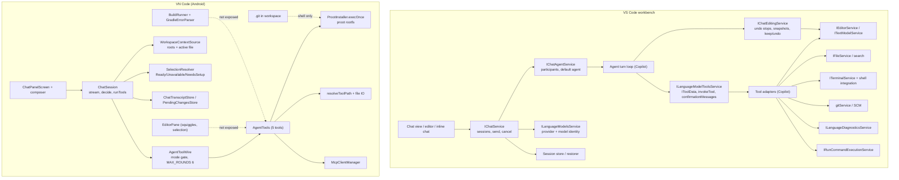

# VS Code + Copilot vs VN Code: capability and architecture audit

Research date: 2026-10-30. Scope: how VS Code's chat panel is wired into the whole application, what the Copilot agent runtime does, and where VN Code stands against it. Read-only: no production file, test, dependency or build configuration was changed to produce this report.

## 1. Executive summary

VS Code's chat is not a feature bolted onto an editor. It is a workbench contributor that owns a `IChatService` with session state, a `IChatEditingService` with undoable edit sessions, a `ILanguageModelToolsService` that is a general tool dispatch and approval bus, and a participant registry that lets any extension register an agent. Every capability a user attributes to "Copilot" is really one of three layers: a native workbench service, a Copilot extension tool that calls that service, or a language model choice. This audit separates those layers explicitly.

VN Code's equivalent is a purpose-built, on-device agent: a text-protocol tool loop in `ChatSession` plus `AgentToolWire` (mode gating, six-round cap), five tools executed inside the proot rootfs through `AgentTools`, an approval gate (`ChatPermissionStore`), staged writes for EDIT mode (`PendingChangesStore`), and a chat panel that owns provider/model selection with real storage-safety guarantees.

The practical difference is context breadth, not reasoning. VN Code's agent can run commands and touch files, but it cannot see the editor's selection, the LSP diagnostics, the git diff structure, the test results, or the terminal's live output, because none of those are exposed as tools or as prompt context. VS Code's advantage is that its tools are thin wrappers over the same services the UI already uses.

Highest-value, lowest-cost direction for VN Code: make the IDE's existing state readable by the agent (selection, diagnostics, git status and diff, build output), then let it verify its own work by reading build and test results it already produces.

## 2. Research methodology

1. Enumerated both repositories' file trees through the GitHub trees API at the revision under audit.
2. Selected files by following the actual call chain from the chat contribution inward (chat service, agent registry, tool service, editing service, context/attachment actions), then outward into Copilot's tool implementations and platform services (terminal, commands, diagnostics, SCM).
3. Fetched raw file contents at the pinned revision and grepped for exported interfaces, classes and method names. Line numbers in this report are from those pinned files.
4. For VN Code, inspected the repository at `dd70884`, grepped the real call paths (`ChatSession` loop, `AgentToolWire.decide`, `AgentTools.executeTool`, `WorkspaceContextSource.warm`), and treated absence of a symbol as MISSING only after searching the whole module.
5. Anything that could not be traced to source is labelled UNKNOWN or recorded in section 23.

Limitations stated up front: the two repositories were read at one revision each, some Copilot tool bodies live behind build-time generated registries, and no runtime profiling was done on either product.

## 3. Source repository revisions

| Repository | Revision | Date | Role |
|---|---|---|---|
| microsoft/vscode | `ce233327f26ef7791b7fff0143c24e81a8126bd2` | 2026-10-30 | Workbench: chat service, editing service, tool service, agents, context |
| microsoft/vscode-copilot-chat | `5863f5a7088958050792b5dccbe8b46c6e13eccc` | 2026-05-20 | Copilot extension: tools, prompts, terminal, SCM, diagnostics glue |
| wisdom131-max/codespace-ide-mobile (VN Code) | `dd7088447f4e57dc5da2ab250d9a96cd3badf974` | 2026-10-30 | Android IDE under audit |

Permalink pattern used below: `https://github.com/microsoft/vscode/blob/ce233327f26ef7791b7fff0143c24e81a8126bd2/<path>` and `https://github.com/microsoft/vscode-copilot-chat/blob/5863f5a7088958050792b5dccbe8b46c6e13eccc/<path>`.

## 4. VS Code chat architecture

### 4.1 Registration and surfaces

Chat is a workbench contribution under `src/vs/workbench/contrib/chat/`. It registers a view container with a chat view, a chat editor (`ChatEditorInput`, openable in the editor area, including the modal editor part used by the models management view), and inline chat as a separate contribution. The same service stack backs all three surfaces, which is why a fix in the service shows up in the sidebar, the editor tab and inline chat.

### 4.2 Service stack, module by module

| Layer | File | Symbol | Line |
|---|---|---|---|
| Service contract | `src/vs/workbench/contrib/chat/common/chatService/chatService.ts` | `IChatService` | 2158 |
| Send contract | same | `sendRequest(sessionResource, message, options)` returning `ChatSendResult` | 2218, union at 1943 |
| Cancel contract | same | `cancelCurrentRequestForSession(sessionResource, source)` | 2227 |
| Implementation | `src/vs/workbench/contrib/chat/common/chatService/chatServiceImpl.ts` | `class ChatService` | 218 |
| Send implementation | same | `sendRequest` → `sendRequestInternal` | 1528, 1539 |
| Cancel implementation | same | `cancelCurrentRequestForSession` | 2637 |
| Queued requests | same | queue drain calling cancel with reason `queueRunNext` | 2844, 2865 |
| Agent registry | `src/vs/workbench/contrib/chat/common/participants/chatAgents.ts` | `IChatAgentService` | 255 |
| Agent registration | same | `registerAgent(id, data)`, `registerAgentImplementation(id, impl)` | 263, 264 |
| Agent lookup | same | `getAgent`, `getDefaultAgent(location, mode)` | 277, 287 |
| Tool contract | `src/vs/workbench/contrib/chat/common/tools/languageModelToolsService.ts` | `IToolData` | 45 |
| Tool approval metadata | same | `confirmationMessages` | 435 |
| Tool implementation | same | `IToolImpl`, `prepareToolInvocation`, `invokeTool` | 441, 443, 717 |
| Edit sessions | `src/vs/workbench/contrib/chat/common/editing/chatEditingService.ts` | `IChatEditingService` | 40 |
| Edit session | same | `IChatEditingSession`, `startExternalEdits`, `getSnapshotModel` | 144, 163, 173 |
| Mode on an edit session | same | `modeId: 'ask' | 'edit' | 'agent' | 'custom'` | 98 |
| Context attachment | `src/vs/workbench/contrib/chat/browser/actions/chatContext.ts` | `asAttachment(...)` producing `IChatRequestVariableEntry` with `kind: 'file'` | 153, 411, 422 |
| Model catalogue | `src/vs/workbench/contrib/chat/common/languageModels.ts` | `ILanguageModelChatMetadata` (`vendor`, `version`, `family`), identifier `<vendor>/<group>/<id>` | 261, 351 |
| Model restore | `src/vs/workbench/contrib/chat/common/modelSelection.ts` | `ModelIdentifierResolution` (`pending`/`available`/`unavailable`), `resolveModelIdentifierFromCatalog` | 16, 28, 48 |

### 4.3 How the parts talk

The chat view is a controller over `IChatService`. The controller collects the prompt text plus a list of `IChatRequestVariableEntry` attachments, then calls `sendRequest`. The service resolves the participant (agent) via `IChatAgentService`, resolves the model via the language models service, builds the request, streams response parts back through an observable response model, and records the request in a session object that is persisted and restorable. Tool calls do not go through the chat service: the agent implementation calls `ILanguageModelToolsService.invokeTool`, which is the same path the UI uses to list tools, so approval metadata is uniform.

State ownership, in one sentence each: the service owns sessions and requests, the agent owns the per-turn loop, the editing service owns file mutations and their undo stops, the tools service owns tool metadata and invocation, and the view owns only rendering plus input state.

## 5. VS Code application integration architecture

Chat reaches the rest of the application through services it receives by dependency injection, never by reaching into UI. The important contracts:

| Contract | Path | Why it matters |
|---|---|---|
| `IEditorService` | `src/vs/workbench/services/editor/common/editorService.ts` | Open editors, active editor, reveal, diff editors |
| `IFileService` / `ITextFileService` | `src/vs/platform/files/common/*` | Read and write any workspace file, including unsaved models |
| `ITerminalService` | copilot `src/platform/terminal/common/terminalService.ts` (`createTerminal` at 33, last command at 50) | Create terminals, run and observe commands |
| `IRunCommandExecutionService` | copilot `src/platform/commands/common/runCommandExecutionService.ts` (`executeCommand` at 13) | Execute any command id, i.e. any workbench capability |
| `ILanguageDiagnosticsService` | copilot `src/platform/languages/common/languageDiagnosticsService.ts` (`getDiagnostics` 16, `getDiagnosticsAtSelection` 66) | LSP and compiler problems, scoped to a range |
| SCM / git | copilot `src/extension/tools/node/scmChangesTool.ts` (`GetScmChangesTool`, `gitService.activeRepository`, lines 40-76) | Structured change list, not shell parsing |
| `ILanguageModelsService` | `chat/common/languageModels.ts` | Provider and model catalogue with identity |
| `IAuthenticationService` + secret storage | `src/vs/platform/authentication/*`, `src/vs/base/parts/secrets/*` | Account-scoped tokens, per-provider API keys |
| `IExtensionService` / registry | `src/vs/workbench/services/extensions/*` | Third-party tools and agents |
| Commands, quick picks, notifications, output channels | `src/vs/platform/commands`, `.../quickinput`, `.../notification`, `.../output` | Agent-visible UI actions and reporting |

Because `executeCommand` can invoke any registered command, the chat agent's reach is effectively the entire command surface of the product, gated only by the tool layer.

## 6. Copilot agent execution architecture

Verified flow for one turn, as implemented in the Copilot extension against the contracts above:

1. **Turn start.** The chat service sends the request to the selected participant's `IChatAgentImplementation`. The participant is chosen by `IChatAgentService.getDefaultAgent(location, mode)` or by explicit selection.
2. **Context assembly.** Attachments arrive as `IChatRequestVariableEntry` items (`chatContext.ts:422`). Workspace context is added by prompt builders, not by the chat service.
3. **Model call.** The participant calls `vscode.lm.sendRequest` or the extension's own streaming client. Streaming parts are progress items returned through the response stream.
4. **Tool advertisement.** Tools are declared through `IToolData` metadata (`languageModelToolsService.ts:45`) and either native function calling or an injected schema block.
5. **Tool call.** `invokeTool` (`:717`) is called per call. Before invocation, `prepareToolInvocation` (`:443`) may return `IPreparedToolInvocation`, and `confirmationMessages` (`:435`) drives the approval UI.
6. **Tool body.** Each tool is a small adapter: `GetScmChangesTool.invoke` (lines 52-76) resolves a repository through `gitService` and returns text; terminal tools create a terminal through `ITerminalService` and read shell integration output; diagnostics tools call `ILanguageDiagnosticsService.getDiagnostics`.
7. **Result return.** Tool results are typed parts (`LanguageModelToolResult`), appended to the session as tool-result messages, and the loop re-enters the model call.
8. **Edits.** File changes go through `IChatEditingService` (`chatEditingService.ts:40, 144`), which creates an editing session with undo stops and snapshot models (`:173`), so the user can review and keep or undo per file.
9. **Cancellation.** A `CancellationToken` threads through every call; the chat-level cancel is `cancelCurrentRequestForSession` (`chatServiceImpl.ts:2637`).
10. **Persistence.** Sessions are stored as session resources; `remoteChatSessionRestorer.ts` restores remote sessions, and model selection restores through `IChatSelectionState` with profile-scoped storage.

Feature separation, stated precisely: the agent loop, tool schemas and tool bodies are Copilot extension code; the tool bus, confirmation model, editing sessions, agents registry, model catalogue and session store are VS Code native; the actual models are external services; and anything a third-party extension registers is extension-supplied.

## 7. Chat to editor

How context is obtained: the active editor's URI, selection, language id and dirty state come from `IEditorService` and `ITextModelService`; selections become attachment entries with ranges; diagnostics come from `ILanguageDiagnosticsService.getDiagnostics(uri)` and can be narrowed to the selection with `getDiagnosticsAtSelection` (`:66`). Unsaved buffers are read from the text model, not from disk, which is why the agent can reason about unsaved edits.

How changes are applied: the agent does not write files directly for chat edits. It returns edits into a chat editing session (`IChatEditingService`), which produces modified-file entries, decorations, hunk navigation and keep/undo actions (`chatEditingService.ts:117-118` comment; `keep`/`undo` surface on `IChatEditingSession`). Bulk application uses `startExternalEdits` (`:163`) for edits produced outside the tool stream, and snapshots at `getSnapshotModel` (`:173`) allow diffing before and after an undo stop.

Consequence worth noting: single-file tool writes and multi-file agent edits use different pipelines, with the reviewable one being the editing session.

## 8. Chat to Explorer

Workspace folders come from the workspace service; the explorer is a view over the file service. The agent typically never touches the explorer directly: file creation, deletion, rename and move are file-service operations, and the explorer re-renders from file-system events. File search uses the search service (ripgrep-backed), not directory walking, which is why result limits and ignore rules behave the same for the agent and for Ctrl+Shift+F. Attachments are file URIs, sometimes with a range, produced by `chatContext.ts:422`.

## 9. Chat to terminal

`ITerminalService` (`createTerminal` at 33) plus VS Code's shell integration is the mechanism. Verified contracts in the Copilot platform layer: terminal creation (`:33`), the last executed command (`:50`), and path contribution (`:70`). Shell integration is what makes "did it succeed" answerable: the terminal reports command start, command end and exit code, so the agent receives an exit code rather than parsing stdout. Terminal selection and buffer text are exposed through proposed API surfaces (`vscode.proposed.terminalSelection.d.ts`, `terminalDataWriteEvent`, `terminalExecuteCommandEvent`) which the extension consumes.

Approval: terminal commands are the canonical example of a tool with `confirmationMessages` (`languageModelToolsService.ts:435`), so the user sees the exact command before it runs, and a "always allow this command" style decision is stored by the tool layer rather than by the model.

## 10. Chat to Git

Copilot has a dedicated tool, not shell parsing: `GetScmChangesTool` (`src/extension/tools/node/scmChangesTool.ts`, class at 40, `invoke` at 52) resolves the repository through `gitService.activeRepository` and returns structured changes. Staging, committing and branching are not performed by that tool; they remain native SCM commands (`git.stage`, `git.commit`) or shell commands the user approves. That split matters for our comparison: VS Code/Copilot gives the agent structured read access to changes, and leaves writes to the command surface plus approval.

## 11. Chat to diagnostics and testing

Diagnostics: `ILanguageDiagnosticsService` (`getDiagnostics` at 16) with a selection-scoped helper (`:66`) is the contract; the Copilot CLI tool `src/extension/chatSessions/copilotcli/vscode-node/tools/getDiagnostics.ts` is one consumer. Because diagnostics come from the language server, both compiler errors and linter warnings arrive through one path.

Testing: test discovery and execution are commands (`testing.*`) rather than a chat service API; the agent reaches them through `executeCommand` (`runCommandExecutionService.ts:13`) and reads results from the testing service or from a task. Debugging likewise: `vscode.debug` plus DAP sessions, reached through commands and the debug service, with no chat-specific contract.

## 12. Chat to settings and application services

Settings, keybindings and workspace configuration are read through the configuration service, and chat settings themselves are ordinary settings plus the models configuration file. Authentication and secrets are separate: account tokens via the authentication service, per-provider API keys through secret storage keyed per provider and optionally per model. Network is the extension host's fetcher, with a mandatory user-agent and domain checks. Telemetry is opt-out and goes through the telemetry service, never through the model. Notifications, output channels and status bar entries are all available to the agent as ordinary workbench services, and `IStatusEntry`-style per-provider status exists for model groups. Webviews and quick picks are UI surfaces any extension can use; chat is a consumer, not the owner.

## 13. VN Code architecture (verified)

| Area | Implementation | Evidence |
|---|---|---|
| Agent loop | `chat/panel/ChatSession.kt`: `sendCore` streams, then `AgentToolWire.decide(mode, buffer, round)` decides Answer / Refused / Run; `runTools` executes and re-enters | `ChatSession.kt:491-504`, `584` |
| Step limit | `AgentToolWire.MAX_ROUNDS = 6`, refusal text "Stopped after 6 steps" | `AgentToolWire.kt:37, 114-117, 155` |
| Tool protocol | Text blocks `<tool>{"name":...}</tool>`, not native function calling; parsed by `CALL_REGEX` | `AgentToolWire.kt:12-14, 40, 86` |
| Mode gating | ASK gets read-only tools, EDIT gets read/write/list/search, AGENT gets all but secret tools | `AgentToolWire.kt:56-60` |
| Tools | `agent/AgentTools.kt`: `run_command`, `read_file`, `write_file`, `list_files`, `search_files`, plus MCP dispatch | `AgentTools.kt:151, 170-190, 222` |
| Shell execution | `run_command` runs inside the proot rootfs via `ProotInstaller.execOnce`, with host→guest workdir translation | `AgentTools.kt:243-266` |
| File tools | `resolveToolPath`, `readFile`, `writeFile`, `listFiles`, `searchFiles` | `AgentTools.kt:283-345` |
| Approval | `ChatPermissionStore` plus the AgentFlowGate AUTO/MANUAL decision referenced at the dispatch site | `AgentTools.kt:218` |
| Staged writes | EDIT mode writes are proposed, not applied, until accepted; `PendingChangesStore` holds them | `AgentToolWire.kt:77-78`, `ChatSession.kt:564-575` |
| Chat UI | `ChatPanelScreen.kt` (composer, rows, model/provider dialogs, endpoint editor), `ChatInputComposer.kt` | verified |
| Selection | `SelectionResolver` with `Ready` / `Unavailable` / `NeedsSetup`; send-time URL re-resolution | `SelectionResolver.kt:18-131`, `ChatSession.kt:692` |
| Persistence | `ChatSettingsPrefs` (selection, overrides), `ChatTranscriptStore`, `CustomEndpointStore` (models, live cache, status-free) | verified |
| Workspace context | `WorkspaceContextSource.warm` builds a multi-root block with the active file | `WorkspaceContextSource.kt:29-93` |
| MCP | `McpClientManager.callTool` shares the dispatch path and the approval gate | `AgentTools.kt:217-222` |
| Attachments | System picker, bytes staged at attach time, chips rendered in the composer | `ChatPanelScreen.kt:103-107, 158, 214` |

What is absent, after searching the module: any read of editor selection or cursor into the prompt, any diagnostics in the prompt or as a tool, any structured git API, any test or debug integration, and any terminal session object the agent can observe after a command returns.

## 14. Complete capability comparison

Status: IMPLEMENTED, PARTIAL, MISSING, UNKNOWN. Layer: N = native VS Code, C = Copilot extension, X = third-party extension, S = external service.

### 14.1 Chat surface and session

| Capability | VS Code | VN Code | Status | Evidence |
|---|---|---|---|---|
| Sidebar chat + editor-tab chat + inline chat on one service | N: three surfaces over `IChatService` | Single Compose panel, no editor-tab chat, no inline chat | PARTIAL | `chatService.ts:2158`; `ChatPanelScreen.kt` |
| Session persistence and restore | N: session resources, restorer | Transcript store per project | IMPLEMENTED (narrower) | `remoteChatSessionRestorer.ts`; `ChatTranscriptStore.kt` |
| Multiple concurrent sessions / tabs | N | One session per project | MISSING | `chatServiceImpl.ts:218` |
| Streaming responses | N | Yes, SSE via adapters | IMPLEMENTED | `ChatSession.sendCore` |
| Cancellation | N: `cancelCurrentRequestForSession` | Coroutine cancel on stop | IMPLEMENTED | `chatServiceImpl.ts:2637` |
| Message actions (copy, retry, edit) | N | Copy, retry present in row actions | PARTIAL | `ChatRowModel` usage |
| Attachments | N: any URI, range, symbols, diagnostics | File picker bytes only, no range or symbol | PARTIAL | `chatContext.ts:422`; `ChatPanelScreen.kt:214` |
| Mode selection (ask/edit/agent) | N: `modeId` on edit session | `ChatMode` gating tools | IMPLEMENTED | `chatEditingService.ts:98`; `AgentToolWire.kt:56` |
| Participant / agent selection | N: `IChatAgentService`, default agent per location+mode | No participant registry, one built-in agent | MISSING | `chatAgents.ts:255-287` |
| Model and provider selection | N + S: models service with identity | `SelectionResolver` + `CustomEndpointStore`, per-endpoint keys | IMPLEMENTED | `languageModels.ts:261,351`; `SelectionResolver.kt` |

### 14.2 Tools and agent runtime

| Capability | VS Code | VN Code | Status | Evidence |
|---|---|---|---|---|
| Tool registry with schemas | N: `IToolData`, `IToolImpl` | Static list plus text schema in the prompt | PARTIAL | `languageModelToolsService.ts:45,441`; `AgentTools.kt:151` |
| Native function calling | N/C: typed tool calls | Text `<tool>` protocol only | PARTIAL | `AgentToolWire.kt:12` |
| Tool approval | N: `confirmationMessages` per tool | Permission store plus AUTO/MANUAL gate | IMPLEMENTED | `languageModelToolsService.ts:435`; `AgentTools.kt:218` |
| Step / round limit | N: agent-defined | 6 rounds | IMPLEMENTED | `AgentToolWire.kt:37` |
| Parallel tool calls | N/C: supported by the loop | Sequential only | MISSING | `ChatSession.runTools` |
| Edit review with keep/undo per hunk | N: `IChatEditingSession` | Staged proposals, accept per file | PARTIAL | `chatEditingService.ts:144-173`; `PendingChangesStore.kt` |
| Multi-file edits in one turn | N/C: editing session across files | Multiple staged writes allowed, no grouped review | PARTIAL | `PendingChangesStore.kt` |
| Context compaction / token budgeting | C: prompt builders and budgets | Per-provider context override, no compaction | PARTIAL | `ChatSettingsPrefs.contextOverride` |
| Planning | C: plan tool and task decomposition | No plan tool (stub removed) | MISSING | `AgentTools.kt:174` |
| MCP | N/C | Implemented and dispatched through the same gate | IMPLEMENTED | `AgentTools.kt:217-222` |
| Sub-agents / custom agents | N: agents registry; C: sub-agent tools | None | MISSING | `chatAgents.ts:263`; `tools/node/executionSubagentTool.ts` |

### 14.3 IDE integration

| Capability | VS Code | VN Code | Status | Evidence |
|---|---|---|---|---|
| Active file in context | N | Yes, via workspace block | IMPLEMENTED | `WorkspaceContextSource.kt:93` |
| Selection and cursor | N | No | MISSING | absence in `chat/panel` |
| Open tabs / unsaved changes | N | Active file only, disk reads | MISSING | `AgentTools.readFile` |
| Diagnostics in prompt or as tool | N/C: `ILanguageDiagnosticsService` | None | MISSING | `languageDiagnosticsService.ts:16` |
| Git status and diff | C: `GetScmChangesTool` | Only via `git` shell command | PARTIAL | `scmChangesTool.ts:40-76` |
| Git commit / branch / stage | N commands, approved | Via shell command | PARTIAL | `AgentTools.runCommand` |
| Terminal run command | N + C | Yes, inside proot | IMPLEMENTED | `AgentTools.kt:243-266` |
| Terminal exit code / live output | N: shell integration | Exit status inferred from captured output, no session object | PARTIAL | `terminalService.ts:50`; `AgentTools.kt:266` |
| Terminal reuse and background processes | N | One-shot `execOnce`, no persistent session | MISSING | `AgentTools.kt:266` |
| File create / delete / rename / move | N file service | Write creates, no delete or rename tool | PARTIAL | `AgentTools.kt:302` |
| Workspace-scoped restrictions | N: workspace trust | Path resolution plus permission gate; MCP shares it | PARTIAL | `AgentTools.kt:283` |
| Tests (discover/run/results) | N commands + testing service | None; `BuildRunner` exists outside chat | MISSING | `BuildRunner.kt` |
| Debugger, breakpoints, stack traces | N debug service | None | MISSING | absence |
| Problems panel feed | N | Editor squiggles only, not exposed | MISSING | `EditorPane` lspSquiggles |

### 14.4 Platform and application services

| Capability | VS Code | VN Code | Status |
|---|---|---|---|
| Settings read/write by agent | N configuration service | Settings read for selection only | PARTIAL |
| Commands / quick picks / context menus | N, agent-reachable via `executeCommand` | Compose UI only, no command surface | MISSING |
| Notifications from agent | N | Notification store exists | PARTIAL |
| Output channels | N | Logcat plus in-app console | PARTIAL |
| Extension system | N, with tool and agent contributions | None | MISSING |
| Auth and secrets | N services, per-provider keys | `SecureTokenStore`, per-provider slots | IMPLEMENTED (scoped differently) |
| Telemetry | N opt-out | None | MISSING |

Count: 41 capabilities compared across 4 tables.

## 15. Missing capabilities (highest signal)

1. Editor selection and cursor as context. The agent cannot be asked "fix this selection" with the selection attached.
2. Diagnostics as context or tool. The agent cannot read the compiler or LSP errors that the editor already displays.
3. Structured git read. Change lists and diffs are unavailable except through shell parsing.
4. Terminal session observation. No exit code contract, no ability to read output after the fact.
5. Test and build verification loop. `BuildRunner` exists but the agent cannot ask for a build and read the structured result.
6. Persistent terminal sessions for long-running processes.
7. Multi-file grouped edit review.
8. Parallel tool execution.

## 16. Partial implementations worth finishing

| Capability | What exists | What is missing to call it done |
|---|---|---|
| Edit proposals | Staged writes with accept | Grouped multi-file review, per-hunk accept, undo after apply |
| Attachments | File bytes from the picker | Ranges, symbols, diagnostics, paste of a code selection |
| Tool schema | Static text block | Per-mode schema with typed parameters and validation |
| Terminal execution | `execOnce` captures output | Exit code, timeout policy, cancellation of a running command |
| Git | `git` via shell | `git status --porcelain=v2` and unified diff parsing into a tool result |
| Workspace context | Multi-root block plus active file | Open buffer contents, dirty markers, per-root ignore rules |

## 17. Security comparison

| Topic | VS Code | VN Code | Assessment |
|---|---|---|---|
| Workspace boundary | Workspace folders, workspace trust gates agent features | Project roots plus proot mapping, `resolveToolPath` | VN Code is stricter by construction; keep |
| Command execution | Approval per tool call with `confirmationMessages` | Approval gate plus mode gating plus permission store | Comparable; VN Code's mode gate is simpler to reason about |
| File writes | Editing sessions with review | Staged in EDIT mode, direct in AGENT mode | VN Code should require review in all modes for destructive writes |
| Secrets | Secret storage per provider, never in settings | Encrypted store, per-provider slot, never logged | Equivalent |
| Prompt injection | Untrusted workspace instructions are surfaced, not blindly obeyed | MCP tool docs and workspace text are injected; no trust boundary | **Gap**: VN Code has no untrusted-content marking |
| Tool isolation | Extension host process | Same process, proot for shell | Acceptable on Android; document it |
| Auditability | Output channels and logs | Breadcrumb log plus chat transcript | Partial |

Recommended safe defaults: writes stay staged until accepted in every mode, deletes and renames require explicit confirmation, shell commands show the exact command with the resolved working directory, MCP tools inherit the same gate, and prompt-injected text is labelled untrusted in the system prompt.

## 18. Android adaptation

Adapt directly: tool schemas as data, approval gate, mode gating, selection and diagnostics as attachments, structured git read, build result parsing (`GradleErrorParser` already exists), session persistence.

Adapt with care: terminal sessions (Android needs a foreground service and a bound proot process rather than a free-running terminal pool); multi-file review (a bottom sheet with a file list, not desktop diff panes); context compaction (token counting per provider, not a fixed window).

Do not copy: language server indexing at desktop scale, a background semantic index, extension host processes, or multi-window editor groups. A file-scoped scan through `searchFiles` plus ripgrep-style patterns is the mobile-appropriate substitute for semantic search; anything heavier will cost battery and data for little gain on a phone-sized project.

## 19. Ranked implementation roadmap

Scoring used: user value (1-5), difficulty (1-5, lower is easier), resource cost, data cost, security risk, dependency depth, impact on usefulness.

### P0, essential for a dependable agent

| # | What it does | VS Code mechanism | VN Code today | Android implementation | Files likely to change | Deps | Tests | Complexity |
|---|---|---|---|---|---|---|---|---|
| P0-1 | Send the current selection and cursor with a message | Attachments as `IChatRequestVariableEntry` with range | Not sent | Capture `TextRange` from the editor bridge, add a `selection` attachment chip, render in prompt as fenced block with file and range | `ChatPanelScreen.kt`, `ChatSession.kt`, `ChatRowModel`, `EditorPane` bridge | editor state already tracked | prompt contains range and text, no full file when selection smaller | Low |
| P0-2 | Read diagnostics as a tool and as context | `ILanguageDiagnosticsService` | Missing | New read-only tool `get_diagnostics(path?)` over the existing squiggle model; cap at N items; include severity and line | `AgentTools.kt`, `AgentToolWire.kt`, `EditorPane`/LSP holder | diagnostic holder must be reachable off-compose | tool returns problems for a file; empty when clean | Medium |
| P0-3 | Observe terminal command outcomes | Shell integration exit codes | Output text only | Have `execOnce` return exit code plus truncated stdout/stderr; tool result states success explicitly | `AgentTools.runCommand`, `ProotInstaller.execOnce` | none | exit code 0 and non-zero cases, timeout case | Low |
| P0-4 | Ask for a build and read structured errors | Commands plus testing service | `BuildRunner` outside chat | New tool `run_build` reusing `BuildRunner` and `GradleErrorParser`, returning parsed errors | `AgentTools.kt`, `BuildRunner.kt`, `GradleErrorParser.kt` | build runner must expose a result object | build success, compile error with file and line, cancellation | Medium |
| P0-5 | Git status and diff as structured data | `GetScmChangesTool` | Shell only | New read-only tool `git_changes` running `git status --porcelain=v2` and `git diff` inside proot, parsed in Kotlin | `AgentTools.kt`, new parser file | proot exec | clean tree, modified file, staged file, rename | Medium |

### P1, major improvements

| # | What it does | VS Code mechanism | VN Code today | Android implementation | Complexity |
|---|---|---|---|---|---|
| P1-1 | Multi-file grouped review | `IChatEditingSession` | Staged writes, per file | Bottom sheet listing staged files with per-file accept and a combined apply | Medium |
| P1-2 | Open buffer awareness | Text model reads | Disk reads | Editor bridge exposes dirty buffers to `read_file` | Low |
| P1-3 | Attachment ranges and symbols | `chatContext.ts` | Bytes only | Extend the attachment model with range and symbol entries | Medium |
| P1-4 | Parallel safe tool calls | Loop support | Sequential | Run read-only tool batches concurrently with a cap of 3 | Medium |
| P1-5 | Prompt injection defence | Untrusted content markers | None | Mark workspace and MCP text as untrusted in the system prompt; refuse secret tools under untrusted input | Low |

### P2, advanced

| # | What it does | Implementation sketch | Complexity |
|---|---|---|---|
| P2-1 | Persistent terminal session tool | Foreground service holding one proot shell, streaming tail into a ring buffer | High |
| P2-2 | Test discovery and run | Parse Gradle test task output into pass/fail per class | Medium |
| P2-3 | Plan tool with step tracking | Re-introduce a plan writer with per-step status rows | Medium |
| P2-4 | Context compaction | Summarize older turns past a token budget | Medium |
| P2-5 | Symbol search | Use the existing LSP document symbols instead of an index | Medium |

### P3, optional

| # | What it does | Why deferred | Complexity |
|---|---|---|---|
| P3-1 | Semantic codebase index | Battery, storage and data cost on a phone | High |
| P3-2 | Debugger tool (breakpoints, stack) | Requires a DAP bridge in the agent path | High |
| P3-3 | Participant registry for custom agents | Valuable but no demand yet | High |
| P3-4 | Inline chat in the editor | Compose overlay work, limited screen space | Medium |

## 20. Top ten recommended features

1. **Selection and cursor attachments.** Without this the agent guesses what "this" means; every code-fix flow becomes reliable the moment the range is explicit.
2. **Diagnostics tool.** The editor already knows what is broken; letting the agent read it turns the agent from a code generator into a fixer.
3. **Exit codes from `run_command`.** "Did it work" is currently inferred from text, which is the weakest link in every verification loop.
4. **`run_build` with parsed Gradle errors.** Verification becomes real: build, read errors, fix, rebuild.
5. **Structured `git_changes`.** Reviewing its own work needs a change list and diff, not shell text.
6. **Open-buffer awareness.** Editing an unsaved file while the agent reads a stale disk copy is a silent correctness bug.
7. **Multi-file grouped review.** Makes multi-file agent work safe to accept on a small screen.
8. **Terminal session observation (tail + exit).** Required for long builds, dev servers and log reading.
9. **Untrusted-content marking plus secret-tool refusal.** Cheap now, expensive later if MCP growth continues.
10. **Context compaction.** Longer agent sessions stop hitting provider limits mid-task.

## 21. Architecture diagram

## 22. Source references

VS Code at `ce233327f26ef7791b7fff0143c24e81a8126bd2`:

- `src/vs/workbench/contrib/chat/common/chatService/chatService.ts` (`IChatService` 2158, `sendRequest` 2218, `cancelCurrentRequestForSession` 2227, `ChatSendResult` 1943)
- `src/vs/workbench/contrib/chat/common/chatService/chatServiceImpl.ts` (`ChatService` 218, `sendRequest` 1528, `sendRequestInternal` 1539, cancel 2637, queue 2844)
- `src/vs/workbench/contrib/chat/common/participants/chatAgents.ts` (`IChatAgentService` 255, `registerAgent` 263, `getDefaultAgent` 287)
- `src/vs/workbench/contrib/chat/common/tools/languageModelToolsService.ts` (`IToolData` 45, `confirmationMessages` 435, `IToolImpl` 441, `prepareToolInvocation` 443, `invokeTool` 717)
- `src/vs/workbench/contrib/chat/common/editing/chatEditingService.ts` (`IChatEditingService` 40, `modeId` 98, `IChatEditingSession` 144, `startExternalEdits` 163, `getSnapshotModel` 173)
- `src/vs/workbench/contrib/chat/browser/actions/chatContext.ts` (`asAttachment` 153, 411, `kind: 'file'` 422)
- `src/vs/workbench/contrib/chat/common/languageModels.ts` (`ILanguageModelChatMetadata` 261, identifier 351)
- `src/vs/workbench/contrib/chat/common/modelSelection.ts` (`ModelIdentifierResolution` 16, `resolveModelIdentifierFromCatalog` 48)
- `src/vs/workbench/contrib/chat/browser/chatManagement/chatModelsWidget.ts` (`configureLanguageModelsProviderGroup` call 1697)
- `src/vs/workbench/contrib/chat/browser/languageModelsConfigurationService.ts` (`withLanguageModelsProviderGroups` 215, `configureLanguageModels` 160)

Copilot at `5863f5a7088958050792b5dccbe8b46c6e13eccc`:

- `src/platform/commands/common/runCommandExecutionService.ts` (`IRunCommandExecutionService` 10, `executeCommand` 13)
- `src/platform/terminal/common/terminalService.ts` (`ITerminalService` 13, `createTerminal` 33, last command 50)
- `src/platform/languages/common/languageDiagnosticsService.ts` (`getDiagnostics` 16, `getDiagnosticsAtSelection` 66)
- `src/extension/tools/node/scmChangesTool.ts` (`GetScmChangesTool` 40, `invoke` 52)
- `src/extension/tools/vscode-node/tools.ts` (211 lines, tool definitions), `toolsService.ts` (328 lines, dispatch)
- `src/extension/byok/vscode-node/customOAIProvider.ts` (`resolveCustomOAIUrl` 19), `abstractLanguageModelChatProvider.ts` (`getAllModels` 104, `getModelsDiscoveryUrl` 180)

VN Code at `dd7088447f4e57dc5da2ab250d9a96cd3badf974`:

- `android/app/src/main/java/com/codespace/ide/chat/panel/ChatSession.kt` (491-504 decide, 584 runTools, 564 staged)
- `android/app/src/main/java/com/codespace/ide/chat/panel/AgentToolWire.kt` (37 MAX_ROUNDS, 56-60 mode gate, 86 parse)
- `android/app/src/main/java/com/codespace/ide/agent/AgentTools.kt` (151 names, 170 dispatch, 243 runCommand, 283 path resolution, 302 writeFile)
- `android/app/src/main/java/com/codespace/ide/chat/panel/WorkspaceContextSource.kt` (29-93)
- `android/app/src/main/java/com/codespace/ide/chat/panel/SelectionResolver.kt` (18-131)
- `android/app/src/main/java/com/codespace/ide/build/BuildRunner.kt`, `GradleErrorParser.kt`

## 23. Unverified findings and limitations

1. Copilot's per-tool schema bodies are partly generated at build time (`src/extension/tools/vscode-node/allTools.ts`); tool count and ordering were inferred from file layout, not executed.
2. Parallel tool execution in VS Code is inferred from the loop and tool contracts, not observed at runtime.
3. Terminal exit-code propagation was verified through the `ITerminalService` contract (last command) and proposed shell-integration APIs; the exact Copilot tool shape was not read line by line.
4. Test and debug integration is asserted from the command surface (`executeCommand`), not from a specific Copilot tool body.
5. VN Code's approval behaviour in AUTO versus MANUAL mode was read from the gate reference at `AgentTools.kt:218` and `ChatPermissionStore`; the full gate implementation was not re-read in this pass.
6. No performance or battery measurements were taken for either product.
7. This audit does not claim that any VS Code capability is available to Copilot merely because it exists in the workbench; section 14 states the layer explicitly for each row.
